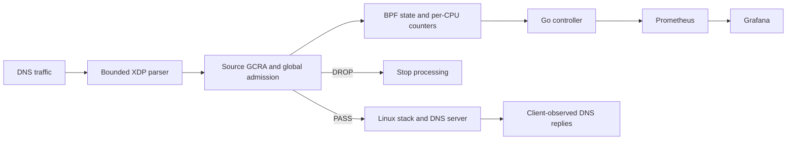

# ByteGuard

ByteGuard is the AIORI-3 Hackathon **PS-022** implementation of DNS query-flood admission control using Linux XDP/eBPF. It combines shared per-source GCRA state with one global token bucket and exports kernel decision counters through a Go controller, Prometheus and Grafana.

**Team:** A3-PS022-TC127 — Prashant Sengar and Janhvi Gokhale

**Institution:** Indian Institute of Information Technology, Design and Manufacturing, Jabalpur

**Faculty mentor:** Dr. Nitish Andola

Read the [technical report PDF](reports/ByteGuard_Technical_Report.pdf), its [editable source](reports/source/report.md). The [original proposal](A3-PS022-TC127_ByteGuard_Proposal.pdf) and [team introduction video](https://youtu.be/mlLHwwHBs1s) remain available.

## What is implemented

- Bounds-checked Ethernet → IPv4 → UDP → fixed DNS-header classification.
- Shared `BPF_MAP_TYPE_LRU_HASH` source state: 64-bit GCRA TAT, 100 queries/s, burst 10, four bounded CAS attempts.
- One shared fixed-point global bucket: 1000 queries/s, burst 200, synchronized by `bpf_spin_lock`.
- Reserve/commit/refund handling, including concurrent `BPF_NOEXIST` insertion races.
- Twelve per-CPU statistics counters, Go aggregation and `/metrics` export.
- An isolated demonstration, three-mode benchmark harness and provisioned Grafana dashboard.

These are admission limits, not measured processing-capacity claims. **XDP admission is not a completed DNS response.** The current policy does not recognize or prioritize legitimate clients; distributed traffic can consume the shared budget.

## Architecture



For an existing source: read eligibility → reserve global token → CAS source TAT → refund if commit fails. For a new source: reserve globally → insert with `BPF_NOEXIST` → on a collision re-lookup and try CAS; terminal failures refund. The operations are not one atomic transaction across maps.

| Map | Role |
|---|---|
| `source_map` | Shared IPv4 source history, bounded to 1024 LRU entries |
| `global_map` | One non-evictable array entry holding the spin lock, credit and refill time |
| `stat_map` | Twelve per-CPU counters summed across all possible CPUs |

See [architecture and project flow](docs/architecture.md) for parsing, concurrency, counter semantics and the separate demo/benchmark topologies.

## Requirements

The reference workflow is **Linux**, with BPF syscall, XDP, BPF links, spin locks, BPF atomics and network namespaces enabled. The documented target is kernel 5.15+; actual verifier/device support must still be checked. Existing records are from an Arch Linux custom kernel; Ubuntu 24.04+ is a documented deployment target, not a separately recorded comparative test environment.

- Root for the namespace/veth lab, nftables and kernel tests. Individual capabilities depend on kernel and operation; this repository does not promise a verified capability-only deployment recipe.
- Clang/LLVM with BPF target, C compiler, Make, libbpf development headers and pkg-config.
- Go **1.27.1+**, as specified by `src/controller/go.mod`; automatic toolchain download needs network access or a populated cache.
- Python **3.11+**, Scapy, DNSPerf, tcpreplay, dnsmasq, dig, iproute2, bpftool and nftables.
- Python Matplotlib for plots and the complete report-rendering tests; tcpdump for optional capture evidence.
- Docker Engine and Docker Compose v2+ for monitoring; curl for checks.

Ubuntu dependency example, after reviewing installation privileges:

```bash
sudo apt-get update
sudo apt-get install -y build-essential make clang llvm libbpf-dev pkg-config \
  iproute2 bpftool dnsmasq-base dnsutils dnsperf tcpreplay nftables \
  python3 python3-scapy python3-matplotlib tcpdump curl
```

Install a suitable Go toolchain and Docker/Compose separately. Ubuntu's default Go package can be too old. `dnsmasq-base` supplies the executable without starting a host DNS service. See [setup and troubleshooting](docs/setup.md).

## Quick start

Clone and build as your normal user:

```bash
git clone https://github.com/aiori-hackathon/A3-PS022-TC127.git
cd A3-PS022-TC127
make check-deps
make controller
make test
```

`make controller` produces **`build/byteguard`**, embedding the freshly compiled object. Do not launch either historical executable under `src/controller/`. The build creates the ignored embed object automatically; it is not a required checked-in binary.

Kernel tests require explicit root privileges and do not attach to a host interface:

```bash
sudo make test-core test-core-stress
```

In terminal 1, start the foreground demo:

```bash
sudo python3 scripts/demo.py run
```

This creates only its dedicated client namespace and veth, starts a locally bound DNS server and attaches the new controller to host endpoint `bgdemo-s`. It refuses existing names and conflicting routes. Wait for the controller's attached/listening log. If native veth XDP is unsupported, stop and explicitly choose `run --mode generic`; record that mode and keep it separate from native benchmark results.

In terminal 2, generate real legitimate DNS requests:

```bash
sudo python3 scripts/demo.py query --qps 50 --duration 10
```

In terminal 3, generate a bounded lab flood while repeating the query command:

```bash
sudo python3 scripts/demo.py flood --scenario single --pps 3000 --duration 15
sudo python3 scripts/demo.py flood --scenario distributed --pps 3000 --duration 15
```

The flood commands run sequentially; each stays on the owned veth. For the demonstration, keep legitimate queries running concurrently in the other terminal.

Start monitoring from another terminal:

```bash
make monitoring-up
curl --fail http://localhost:9090/metrics
```

Open Grafana at **http://localhost:3001**, default login **`admin` / `byteguard-demo`**. Dashboard: **ByteGuard → ByteGuard — DNS admission control**. Prometheus is at **http://localhost:9091**. Optional local overrides are documented in [.env.example](.env.example); do not publish your `.env`.

Stop with Ctrl+C in the demo terminal. Normal SIGINT/SIGTERM stops owned processes, releases the XDP link and removes the demo veth/namespace. Then:

```bash
make monitoring-down
```

Monitoring volumes remain. `make clean` removes named compiler outputs and preserves benchmark evidence; it does not stop running programs. After SIGKILL/power loss, inspect `build/demo/active.json` and recover only confirmed demo resources as described in [setup](docs/setup.md).

## Benchmarking and available results

The benchmark uses a separate two-namespace client/server lab with fresh maps/rules for each run. Modes are `none`, `nft` and `xdp`. Scenarios include no attack, `single`, `subnet`, `distributed`, `pulsed` and an explicitly supplied `custom` PCAP.

The prepared Phase 2 profile is 27 runs: baseline, single-source 3000 PPS and distributed-source 3000 PPS; three modes; three paired seeds; 50 legitimate QPS; ten seconds; capture disabled.

```bash
sudo python3 scripts/bench/harness.py matrix --config configs/bench/phase2.toml
sudo python3 scripts/bench/harness.py verify --tag phase2-20261031
sudo python3 scripts/bench/harness.py report --tag phase2-20261031 --charts
```

Use a fresh `--tag` for a separate campaign and use that same tag in verify/report. Stop on failures. Namespace cleanup is automatic on normal/handled exits; inspect interrupted state before using:

```bash
sudo python3 scripts/bench/harness.py cleanup
```

Raw output goes to unique `build/bench/runs/` directories; generated tables/plots go to `build/bench/reports/<tag>/`. The matrix writes reports as root, hence the sudo report example. CLI help is available through `harness.py matrix --help`.

**Evidence status:** the release audit found no completed final Phase 2 campaign. The report uses twelve validated **historical before-tuning** runs, separately from older-schema, capture and XDP-only diagnostic experiments. At 3000 distributed attack PPS, their mean legitimate success was no-filter 100%, nftables 45.9%, XDP 44.1%, with only two trials and substantial variability. These are not final results or evidence of an availability advantage. p95/p99 latency and isolated XDP CPU were not measured.

The [benchmark evidence guide](docs/benchmark-results.md), [raw archive/manifest](reports/evidence/README.md) and [Phase 2 methodology](docs/phase2.md) explain selection and interpretation. The archived evidence can regenerate report figures even when ignored local build outputs are absent.

## Monitoring

The custom exporter exposes twelve `byteguard_*` counters, including queries, XDP admissions, total/reason drops, source-map events, errors and refund calls. The dashboard uses `rate()` for per-second graphs and displays totals and scrape health. Latency, legitimate success and CPU are measured by the benchmark, not synthesized from map counters.

```bash
curl --fail -sG http://localhost:9091/api/v1/query \
  --data-urlencode 'query=byteguard_dns_queries_total'
curl --fail -sG http://localhost:9091/api/v1/query \
  --data-urlencode 'query=rate(byteguard_dns_queries_total[1m])'
```

Require nonempty results and increasing counters under traffic; target UP alone is insufficient. A map-read error makes the scrape fail. The controller binds `:9090` by default; Compose reaches the host through `host.docker.internal`. Grafana reaches Prometheus at `http://prometheus:9090` inside Compose. Case-sensitive [Prometheus.yml](Prometheus.yml) and [provisioning files](configs/grafana/provisioning/) are part of the deployable configuration.

WSL/Docker Desktop can place the gateway on Windows instead of the WSL guest. Configure a reachable target through your own Prometheus config and `PROMETHEUS_CONFIG`; no fixed developer WSL IP belongs in the default setup. See [setup](docs/setup.md) for diagnosis.

## Repository layout

```text
src/xdp/                     Parser, GCRA and global bucket (protected baseline)
src/controller/              Go loader, map reader, exporter and tests
src/tests/                   C/unit/kernel tests and legitimate DNS workload
scripts/demo.py              Foreground controlled DNS/XDP lab
scripts/bench/               Current benchmark harness and preserved legacy helpers
scripts/report/              Evidence audit, PDF build and release validation tools
configs/bench/               Reproducible TOML experiment profiles
configs/grafana/             Dashboard JSON and datasource/dashboard provisioning
Makefile, Makefile.core-test  Build and test entry points
docker-compose.yml           Local Prometheus/Grafana services
Prometheus.yml               Portable Linux scrape configuration
docs/                        Setup, architecture, evidence and release records
reports/                     Final PDF, editable source, figures and frozen evidence
build/                       Ignored generated builds, live logs and raw experiments
```

## Limitations and future work

The baseline classifies untagged IPv4 UDP/53 standard-query fixed headers. IPv6, VLAN, IPv4 fragments, TCP DNS, QNAME parsing and DNS Cookie validation are outside its limiter scope; unsupported classifications and malformed checked headers generally return early PASS. Shared global capacity has no legitimate-client reservation, and LRU eviction can reset retained source history.

Subnet limits, qualified-source history, userspace profiling, authenticated cookie evidence and protected/discovery/shared capacity are **proposed only**. The [technical report](reports/ByteGuard_Technical_Report.pdf) explains their open accounting, compatibility and evaluation questions.


